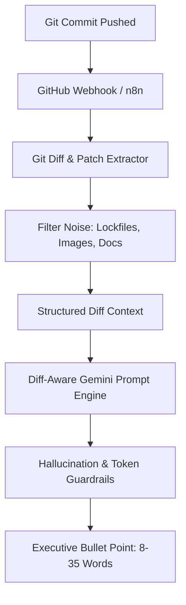

# Technical Architecture Guide: 1-Page Strictness & Git Diff AI Engine

**Document Role:** Person D (AI & Resume Document Architecture Lead)  
**Deliverable:** Day 13 Final Enterprise Documentation  
**Product:** Resume Auto-Updater  
**Version:** 1.1 Production Release  

---

## 1. Executive Summary

The **Resume Auto-Updater** bridges the gap between active code contributions and professional, ATS-optimized engineering resumes. Rather than relying on generic project descriptions or sparse Git commit messages, the system analyzes raw Git commit code diffs, generates high-impact bullet points following Google's **X-Y-Z formula** (`Accomplished [X], as measured by [Y], by doing [Z]`), and guarantees strict **1-page document layout compliance** within `.docx` Word files.

Key capabilities delivered in v1.1:
1. **Git Diff Intelligence**: AST and patch-aware prompt analysis extracting verified frameworks, endpoints, and architectural patterns directly from code diffs with word-boundary matching and zero hallucinated technologies.
2. **1-Page Strictness Guarantee**: Paragraph line budgeting formula, predictive capacity estimation, and automatic 4-step progressive micro-tightening down to 9.5pt.
3. **Smart Project Replacement**: Canonical `replace_project_in_docx` in `docx_engine/page_budget.py` replaces old title lines and all associated bullet points up to the next entry, cloning typography before auto-tightening.
4. **Target Job Description Matcher**: Real-time keyword extraction against canonical taxonomy + aliases, section weighting (Required 2x vs Bonus 1x), difflib fuzzy matching (ratio >= 0.90), honest 0–100 match scoring, and deterministic sorted output.

---

## 2. Git Diff Intelligence Architecture

### The Diff-Aware Extraction Solution
Our ingestion pipeline extracts the patch metadata via GitHub REST API (`GET /repos/{owner}/{repo}/commits/{sha}`):
- Modified file paths (ignoring build artifacts, lockfiles, and images)
- Line additions and deletions
- AST / patch snippets (first 50 lines of relevant diffs)

### Prompt Guardrails & Hallucination Prevention
1. **Unicode Normalization & Injection Neutralization**: Inputs undergo Unicode NFKC normalization and zero-width character stripping. Regex patterns detect adversarial directives and replace them with `[removed]`.
2. **XML Delimiters**: Raw code and repo strings are safely enclosed in `<repo_data>` tags with `<` and `>` escaped.
3. **Strict Truthfulness**: Prompts explicitly forbid inventing metrics or unmentioned technologies. If Gemini returns unverified technologies, the output is rejected and regenerated; if still invalid, a truthful local fallback is used.

---

## 3. 1-Page Strictness Specification & Progressive Tightening

### Typography Budget & Line Formula
A standard US Letter page (8.5" × 11") with 0.5"–0.75" margins accommodates approximately **40 to 48 standard lines** before spilling onto page 2.

The engine calculates lines using actual font size and document margins:
$$\text{Lines Available} = \lfloor \frac{\text{Usable Height (pt)}}{\text{Font Size (pt)} \times \text{Line Spacing}} \rfloor$$
$$\text{Lines Used} = \sum_{p \in \text{paragraphs}} \left( \lceil \frac{\text{len}(\text{text}_p)}{\text{chars\_per\_line}} \rceil + \text{spacing}(p) \right) + \sum_{t \in \text{tables}} (\text{rows}_t \times 1.2)$$

### Progressive 4-Step Auto-Tightening (`auto_tighten_docx_spacing`)
When estimated lines exceed available capacity:
1. **Step 1: Spacing Reduction**: Paragraph `space_after` tightened to `1.5pt` for body bullets and `2pt` for headings; `space_before` set to `0pt`.
2. **Step 2: Line Spacing Tightening**: Decrements line spacing down to `1.05`.
3. **Step 3: Margins Compression**: Dynamically tightens top, bottom, left, and right margins down to `0.5 in` (never below 0.5 in).
4. **Step 4: Font Size Reduction**: Decrements run font size by at most `0.5pt`, strictly enforcing a floor of `9.5pt`.
*Tightening halts immediately at whatever step brings `lines_used <= lines_available`.*

---

## 4. Target Job Description Matching Algorithm

The JD matching engine (`services/jd_matcher.py`) compares candidate resumes against job postings:

1. **Taxonomy & Aliases Normalization**: Canonical normalization maps variants (`postgres` $\to$ `postgresql`, `k8s` $\to$ `kubernetes`, `reactjs` $\to$ `react`, `aws` $\to$ `amazon web services`).
2. **Section Weighting**: Skills under "Required / Must have" count **2.0x** relative to skills under "Nice to have / Bonus" (**1.0x**).
3. **Ambiguous Context Guards**: "Go" is only counted as a programming skill when written as Golang or capitalized in programming context; standalone English "go" is ignored.
4. **Stopword Exclusion**: English grammar words and job posting jargon are stripped; arbitrary length fallbacks have been removed.
5. **Fuzzy Matching**: `difflib.SequenceMatcher` with `ratio >= 0.90` identifies minor typos without false positives.
6. **Honest Scoring**: Computed as $(\text{matched points} / \text{total points}) \times 100$. Returns `0` with message `"no skills detected"` when JD contains no technical skills (no clamping or artificial 70% defaults).
7. **Deterministic Sorting**: Matched and missing keyword lists are sorted by `(-weight, skill_name)`.

---

## 5. ⚠️ Known Limitations
1. **LibreOffice PDF Page Count Verification:** Exact PDF page counting requires a headless LibreOffice installation in the environment (`soffice --headless --convert-to pdf`). On systems where LibreOffice is not installed, geometric line budgeting serves as the fast local proxy.
2. **Complex Layout Tables:** Multi-nested tables with irregular column widths or merged row spans require table flattening for exact character-per-line calculations.
3. **Multi-Page Intentional Resumes:** The 1-page budget engine assumes standard 1-page entry/mid-level engineering resumes. Multi-page CV formats (e.g., academic CVs) should bypass auto-tightening.
