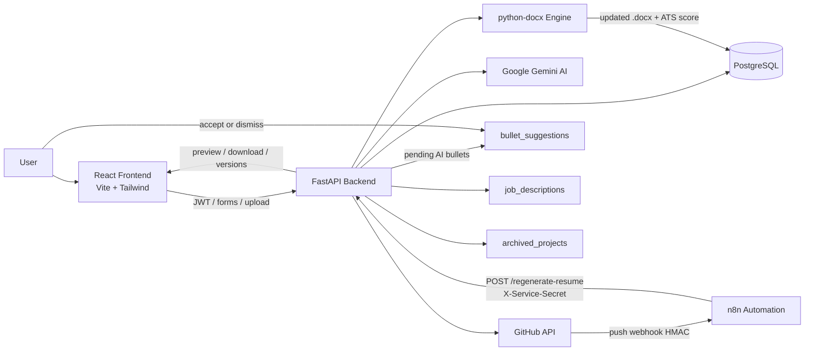

# System Architecture

End-to-end flow for Resume Auto-Updater.

## Human-in-the-loop (Day 11)

AI does not silently overwrite the resume. New bullets land in `bullet_suggestions` with `status = pending`. The dashboard review queue (Person A) lets the user **accept** or **dismiss**. Only accepted text should be injected into the `.docx`.

## Job matcher and 1-page resume (Day 12)

The user pastes a job description. Person D scores it into `job_descriptions` (matched vs missing keywords). If the resume must stay one page, weaker projects move to `archived_projects` instead of being deleted, so a later JD can bring them back.

## What happens on a GitHub push

1. Developer pushes code to `main`.
2. GitHub POSTs a signed webhook to n8n.
3. n8n verifies HMAC, keeps only `main`, then calls FastAPI.
4. FastAPI fetches repos, ranks projects, asks Gemini for bullets, writes a **pending** row in `bullet_suggestions`, and (after accept) rewrites the `.docx`.
5. Success is logged in `automation_logs`. Failure can alert the team channel.

See also `docs/DATABASE_SCHEMA.md` for tables and keys.
