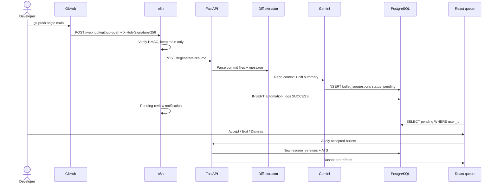
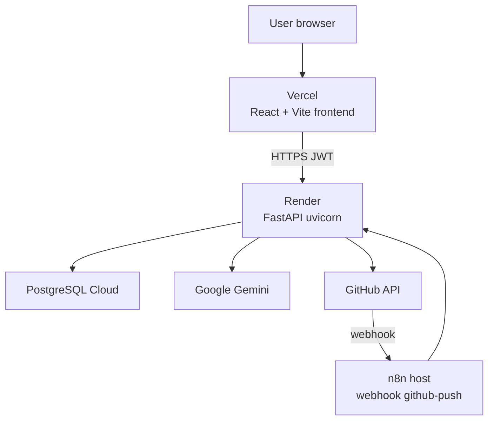

# Master System Architecture v1.1

**Product:** Resume Auto-Updater  
**Role archive:** Person E — Database, Automation & Coordinator  
**Day:** 13 of 13 — Enterprise polish & master demo

This is the final picture of the system: what each box does, how data moves, how we lock it, and how we ship it.

---

## 1. Complete system overview

Resume Auto-Updater keeps a developer’s `.docx` resume in sync with GitHub.

1. The developer **pushes** to `main`.
2. GitHub sends a **signed webhook**.
3. **Two listeners** can catch it:
   - **n8n** (Person E) — visual automation: filter branch, call the API, log SQL, alert the team, notify the review queue.
   - **FastAPI native webhook** (Person C) — same event can hit `/regenerate-resume` directly in production if n8n is down.
4. A **commit diff extractor** turns the push (files added/changed/removed + message) into context for ranking.
5. **Gemini** writes achievement bullets.
6. Rows land in **`bullet_suggestions`** with `status = pending` (Day 11 human-in-the-loop).
7. The **React review queue** lets the user Accept / Edit / Dismiss.
8. Only accepted text goes through the **python-docx 1-page engine**. Extra projects go to **`archived_projects`**. A pasted job post is scored in **`job_descriptions`**.
9. **PostgreSQL** stores everything. The **React dashboard** shows versions, ATS, diffs.

In one sentence: **git push → signed webhook → AI draft → human accept → one-page Word file.**

---

## 2. Mermaid end-to-end architecture

```mermaid
flowchart LR
    Dev[Developer]
    Git[Git Push on main]
    GH[GitHub]
    Native[FastAPI Native Webhook<br/>POST /regenerate-resume]
    N8N[n8n GitHub Trigger]
    Diff[Commit Diff Extractor]
    Gemini[Gemini AI Synthesis]
    Sug[(bullet_suggestions<br/>pending)]
    Queue[React Review Queue<br/>Accept / Edit / Dismiss]
    Docx[python-docx 1-Page Engine]
    JD[JD Matcher<br/>job_descriptions]
    Arch[(archived_projects)]
    PG[(PostgreSQL)]
    Dash[React Dashboard]

    Dev --> Git --> GH
    GH -->|HMAC SHA-256| N8N
    GH -->|HMAC SHA-256| Native
    N8N -->|X-Service-Secret| Native
    Native --> Diff --> Gemini --> Sug
    Sug --> Queue
    Queue -->|accepted| Docx
    Queue -->|dismissed| PG
    Dash --> JD
    Docx --> Arch
    Docx --> PG
    Sug --> PG
    JD --> PG
    PG --> Dash
```

---

## 3. Data flow and sequence

**n8n node order (production workflow):**

1. **Webhook** — GitHub POST.
2. **HMAC Code** — drop the run if signature is wrong.
3. **Parse commit** — `repo_name`, `user_id`, `branch_ref`, `modified_files` (this *is* the diff fetcher input).
4. **Filter** — `branch_ref == main`.
5. **HTTP Request** — FastAPI pipeline.
6. **IF** — HTTP 200 / success vs error.
7. Success: log SQL + **notify pending review queue**.
8. Error: format embed + team channel POST.

---

## 4. Security architecture

| Layer | What we use | Why (plain English) |
|---|---|---|
| Passwords | bcrypt hashes in `users.password_hash` | We store a one-way mash, not the password. |
| Session | JWT on `Authorization: Bearer` | Frontend proves who you are without sending the password every click. |
| GitHub tokens | **Fernet** (AES-128 in CBC + HMAC) in `github_accounts` | If someone dumps the DB they still cannot call GitHub as you. |
| GitHub → n8n | **HMAC-SHA256** header `X-Hub-Signature-256` | Proves the POST really came from GitHub (or our load-test secret). |
| n8n → FastAPI | `X-Service-Secret` | Robots do not have a user JWT; they share a service password. |
| Browser | CORS allow-list | Random websites cannot call the API with your cookie. |

Never commit real secrets. Rotate `JWT_SECRET`, `ENCRYPTION_KEY`, and the webhook secret before a public demo.

---

## 5. Production deployment architecture

| Piece | Where it lives | Notes |
|---|---|---|
| Frontend | **Vercel** | `VITE_BACKEND_URL` points at Render. |
| Backend | **Render** web service (`render.yaml`) | `/health` keep-alive ping. |
| Database | **PostgreSQL Cloud** (Render/Railway/Neon) | Apply `scheme.sql`, `views.sql`, then migrations `002`–`004`. |
| Automation | n8n (local for class, cloud for public GitHub) | GitHub cannot call `localhost` without a tunnel (ngrok). |
| Files | Render disk or object storage | `.docx` paths in `resumes` / `resume_versions`. |

Local fallback: SQLite `resume_auto_updater.db` if `DATABASE_URL` is empty. Production should be Postgres.

---

## 6. What Person E owns in this picture

- Tables, views, indexes, migrations.
- n8n graph + exported JSON in `workflows/`.
- Load test, health monitor, architecture docs.
- Demo segment: **git push → n8n execution green → pending row / notification**.

See also: `docs/DATABASE_SCHEMA.md`, `docs/ARCHITECTURE.md`, `workflows/`.
